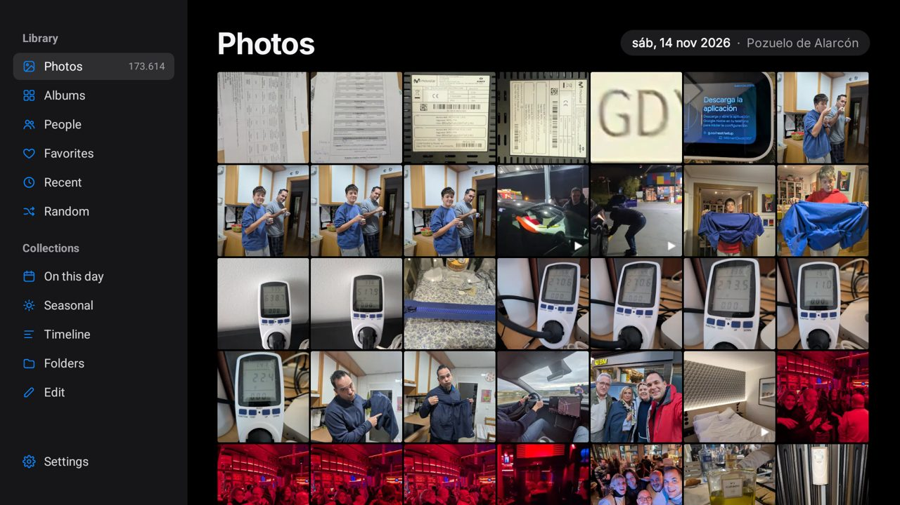
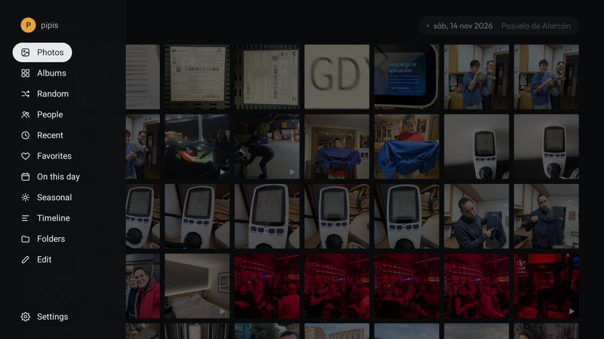
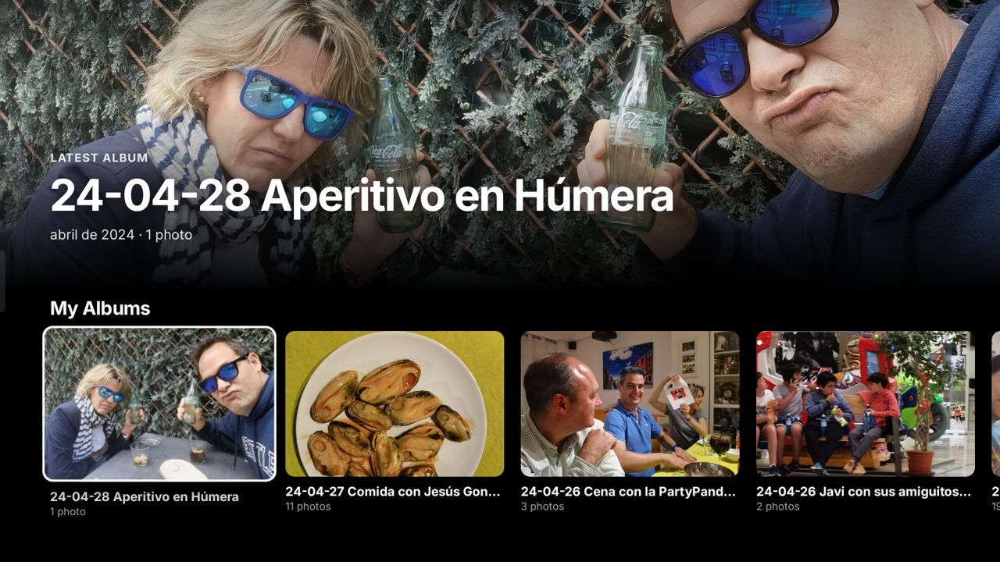
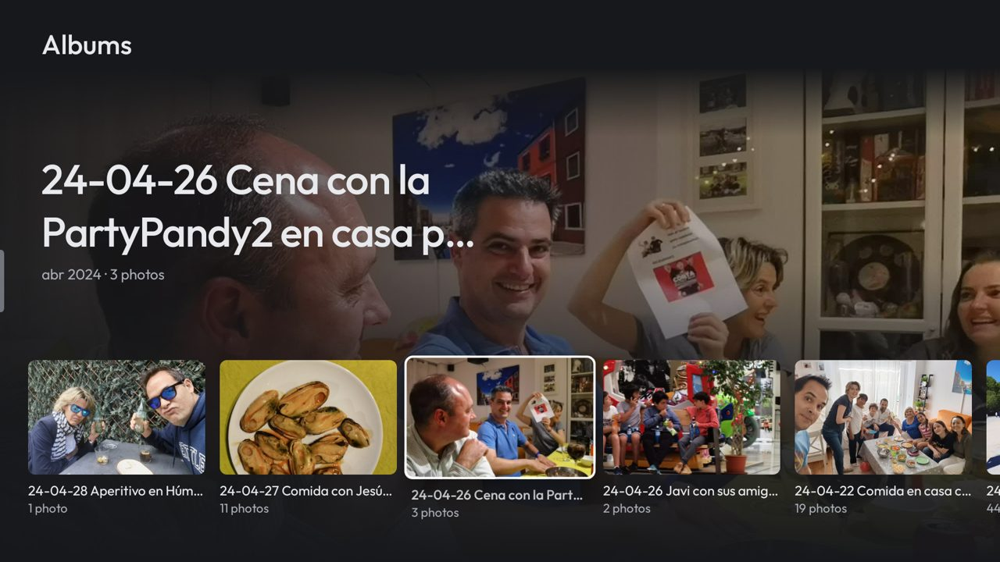
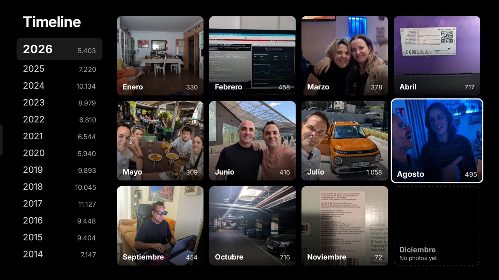
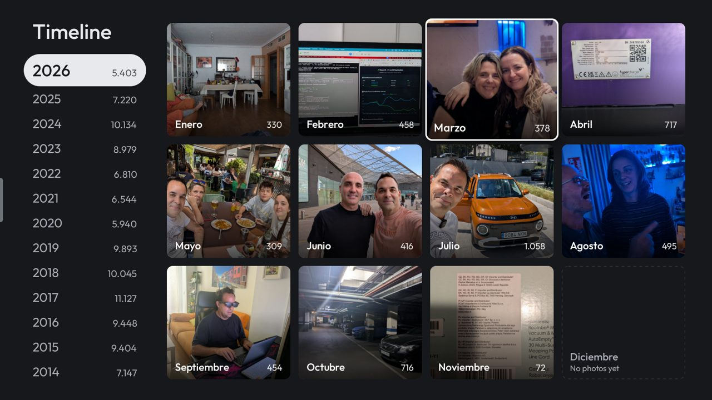
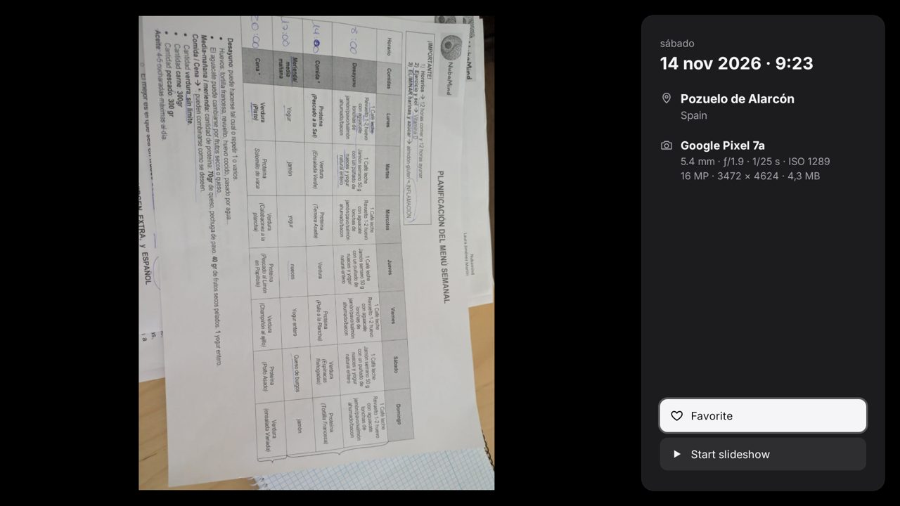
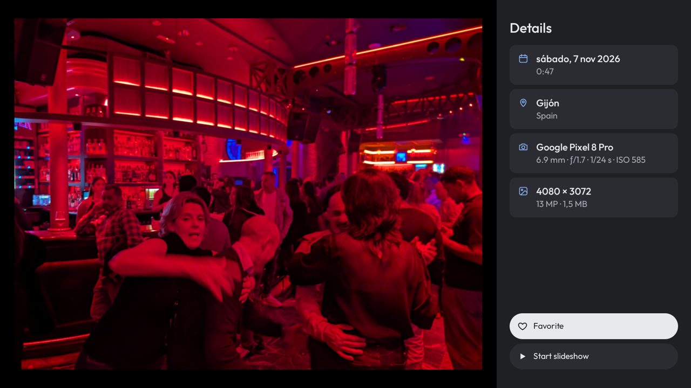

# Immich TV

A personal Android TV client for [Immich](https://github.com/immich-app/immich), the self hosted
photos and videos backup solution. It lets you browse and view what you uploaded, on the big screen.

> **About this project.** Immich TV started as a fork of
> [Immich-Android-TV by giejay](https://github.com/giejay/Immich-Android-TV), who wrote the original
> app and deserves the credit for getting it going. I preferred to take it in my own direction and
> keep a personal version, which has since become very different from what he proposed: a complete
> interface redesign with two selectable styles, new screens, caching, translations and its own
> application id. It is an independent project and is not affiliated with or endorsed by the
> original one. See [NOTICE.md](NOTICE.md) for the copyright and licence details.

## What it looks like now

- **Two interface styles**, selectable in *Settings > View settings > Interface style*:
  **Apple** (Photos-like, black, Inter) and **Google TV** (dark grey, rounded, Outfit). Both share
  the same screens: Photos, Albums, People, Favorites, Random, On this day, Timeline (years and
  months), the photo viewer with its information panel, Edit menu and Settings.
- A side menu that pushes the content aside and hides when you move into the photos.
- A continuous photo grid with a date and place pill that follows the focused photo.
- **Caching** of the sections that rarely change (albums, people, timeline, favorites) so they open
  instantly and only refresh when the server says something changed.
- **Translations**: it follows the language of Android TV (English and Spanish for now).
- **Move to Trash** with the remote's red button (`KEYCODE_PROG_RED`, 183); map it first with an app
  like Key Mapper.
- Screensaver, slideshow, sign in by API key or by phone, and a demo mode.

Developer notes are in [CLAUDE.md](CLAUDE.md) and `docs/redesign/`.

## Immich

Immich is a self hosted backup solution for photos and videos. Current features include:

- Upload and view videos and photos
- Auto backup when the app is opened
- Selective album(s) for backup
- Multi-user support
- Album and Shared albums

More info here: https://github.com/immich-app/immich

## Screenshots

|                                                              Apple style                                                               |                                                                Google TV style                                                                 |
|:--------------------------------------------------------------------------------------------------------------------------------------:|:----------------------------------------------------------------------------------------------------------------------------------------------:|
|  |  |
|  |  |
|  |  |
|  |  |

## Build steps

1. Clone project with `git clone --recurse git@github.com:picajoso/Immich-Android-TV.git`
2. copy `app/strings_other.xml.example` to `app/src/main/res/values/strings_other.xml` (git-ignored) and
   fill in the address and API key of your demo server. Release signing is read from
   `local.properties` (see `app/build.gradle`); without it the debug key is used.
3. Build apk with `./gradlew assembleRelease`

## Contributing

Bug reports and ideas are welcome as issues of this repository. If you like the original app this
one comes from, it was started by [giejay](https://github.com/giejay/Immich-Android-TV).

## FAQ

#### I'n not able to set the app as a screensaver

1. Enable development mode on the device (click the build number or "Android TV OS Build" 7 times in
   the System->About settings).
2. Go to System -> Developer Options and enable USB Debugging.
3. If you don't have ADB installed on your PC, follow these
   instructions: https://www.xda-developers.com/install-adb-windows-macos-linux/
4. After downloading/installing ADB on the PC, connect to the device using it's IP: adb connect
   192.168.xx.xx.
5. Once you are connected, execute the following command: 'adb shell settings put secure
   screensaver_components javipas.android.tv.immich/nl.giejay.android.tv.immich.screensaver.ScreenSaverService'
6. Done!
